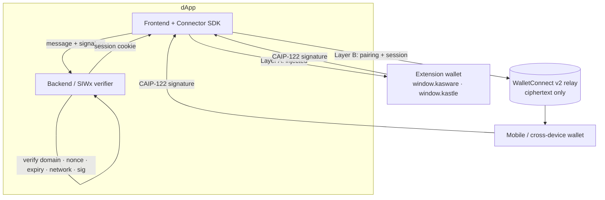
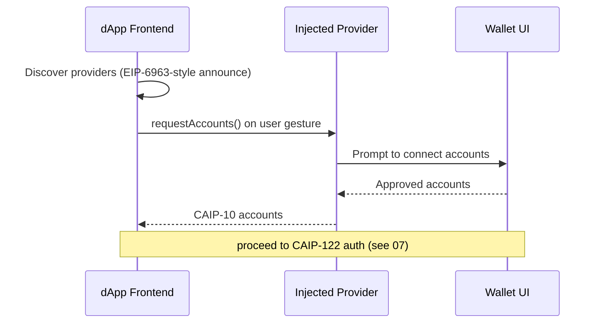
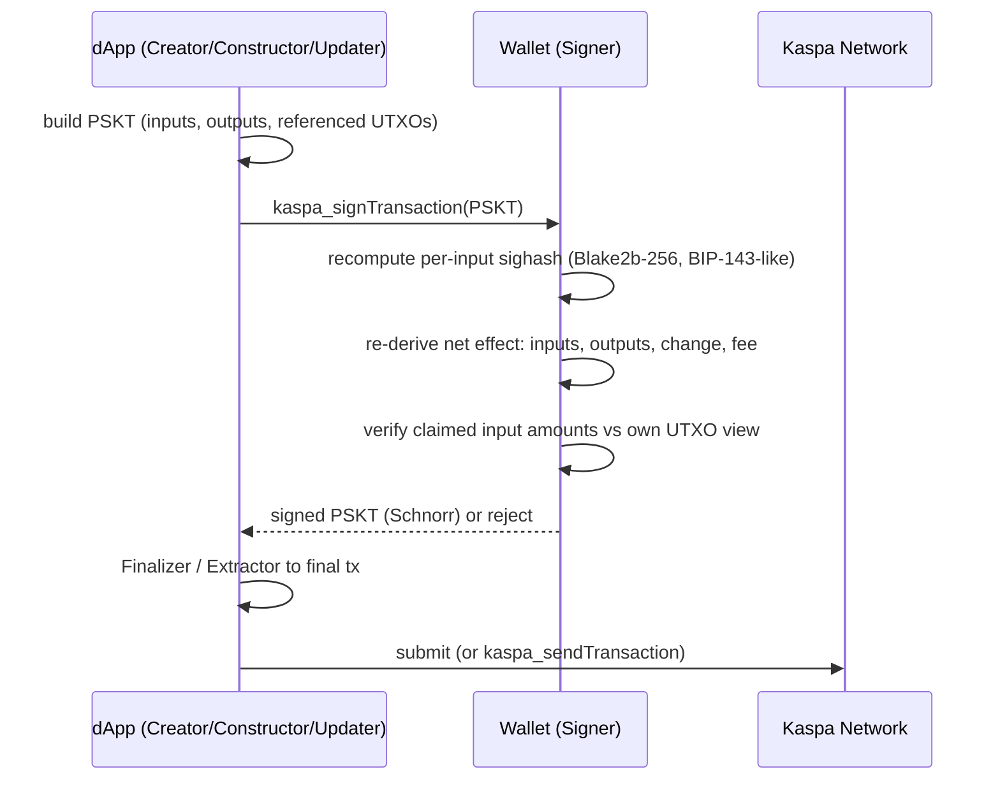
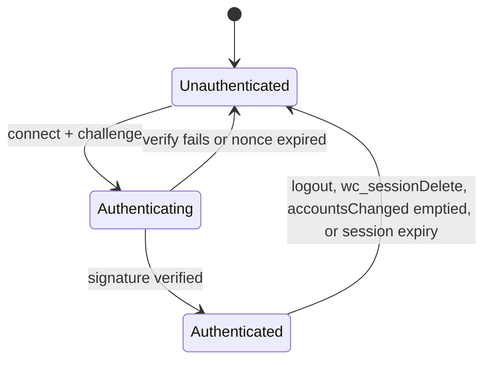

# Kaspa dApp Login — Technical Specification

**A wallet-based login system for Kaspa dApps**

> An authentication and session-connection design for decentralized applications on Kaspa. It composes published, audited standards end to end; the only chain-specific artifact is a namespace *profile* that instantiates those standards with Kaspa's existing cryptographic primitives. No new cryptography is defined.

`Status: DRAFT` · `Normative language: RFC 2119` · `Audience: implementing engineer + auditor` · `Scope: L1 Kaspa login`

---

## Contents

1. [Purpose & guiding principle](#1-purpose--guiding-principle)
2. [Normative language](#2-normative-language)
3. [Standards inventory](#3-standards-inventory)
4. [Architecture](#4-architecture)
5. [Identifiers](#5-identifiers)
6. [Kaspa namespace profile](#6-kaspa-namespace-profile-profile)
7. [Authentication flow (Sign-In with X)](#7-authentication-flow-sign-in-with-x)
8. [Connection transports](#8-connection-transports)
9. [Transaction signing](#9-transaction-signing-post-login)
10. [Security requirements](#10-security-requirements-consolidated)
11. [Session lifecycle](#11-session-lifecycle)
12. [UI ↔ protocol mapping](#12-ui--protocol-mapping)
13. [Standardization tasks](#13-standardization-tasks)
14. [Reference implementations](#14-reference-implementations)
15. [Appendix — examples](#15-appendix--examples)

---

## 1. Purpose & guiding principle

This document specifies a login system that lets a user authenticate to a Kaspa dApp by proving control of a Kaspa account held in their wallet, and optionally authorize the dApp to request transaction signatures during a bounded session. It is written so a single developer can build the backend verifier and the frontend connector against a UI that has already been designed.

The design has one non-negotiable principle, which drives every choice below:

> **MUST NOT** — Invent cryptography or protocol semantics. Every wire format, key-agreement step, signature scheme, and authentication message in this spec is taken from a published standard or from Kaspa's own shipping implementation. Where a detail is not covered by an existing standard, the implementer **MUST** defer to the reference library named in §14 rather than hand-roll a substitute.

Two transports carry the same authentication model:

- **Layer A — injected provider.** For desktop web where the wallet is a browser extension. Wraps the wallet's existing injected object. No relay.
- **Layer B — relay session.** For mobile or cross-device, where the wallet runs on a separate device. Uses the WalletConnect v2 Sign protocol.

Both layers surface an identical connector API to the dApp and feed the identical Sign-In-with-X authentication in §7. The login logic is transport-agnostic; only the plumbing differs.

---

## 2. Normative language

The key words **MUST**, **MUST NOT**, **SHOULD**, **SHOULD NOT**, and **MAY** are used as defined in RFC 2119. A requirement marked **MUST** is load-bearing for security: violating it opens a concrete attack, and each such requirement in §10 names the attack it prevents.

---

## 3. Standards inventory

Everything the system stands on. **[ADOPT]** means used verbatim as published. **[PROFILE]** means the chain-agnostic standard is instantiated for Kaspa using existing Kaspa primitives — the assembly is new, the cryptography is not.

| Standard | Provides | Disposition |
|---|---|---|
| **WalletConnect v2** (Sign, Pairing, Relay, Crypto) | Remote transport: pairing, encrypted relay, session negotiation | **[ADOPT]** |
| **CAIP-2** | Chain identifiers (`kaspa:mainnet`) | **[ADOPT]** |
| **CAIP-10** | Account identifiers (`kaspa:mainnet:<addr>`) | **[ADOPT]** |
| **CAIP-25** | Session authorization scopes (namespaces: chains/methods/events) | **[ADOPT]** |
| **CAIP-122** (Sign-In with X) | The authentication message model — chain-agnostic generalization of Sign-In with Ethereum | **[ADOPT]** |
| **CAIP-74** (CACAO) | Container for the signed capability / auth receipt (header type `caip122`) | **[ADOPT]** |
| **X25519** (RFC 7748), **HKDF-SHA256** (RFC 5869), **ChaCha20-Poly1305** (RFC 8439), **SHA-256** | The WalletConnect v2 crypto envelope: ECDH → key derivation → AEAD → topic | **[ADOPT]** |
| **EIP-1193** | Injected provider request interface shape | **[ADOPT]** |
| **EIP-6963** | Multi-wallet discovery via announce/request events | **[ADOPT]** |
| **EIP-1328** | `wc:` pairing URI format | **[ADOPT]** |
| **secp256k1 Schnorr** (BIP-340 lineage) | Kaspa's signature scheme — already shipping | **[ADOPT]** |
| **Blake2b-256 sighash**, Kaspa BIP-143-like preimage | Per-input transaction signature hash — already shipping | **[ADOPT]** |
| **PSKT** (Partially Signed Kaspa Transaction), BIP-370 / BIP-174 roles | Transaction construction and signing lifecycle — already shipping (`kaspa-wallet-pskt`) | **[ADOPT]** |
| **Kaspa namespace profile** | The CAIP-2/10 identifiers, CAIP-25 method/event set, and CAIP-122 signing profile for the `kaspa` namespace | **[PROFILE]** |

> **NOTE** — The single **[PROFILE]** row is the only net-new artifact. CAIP-122 and WalletConnect namespaces are *designed* to be instantiated per chain; doing so is using them as intended. Every primitive the profile references (Schnorr, Blake2b-256, PSKT, bech32 `kaspa:` addresses) already exists in `rusty-kaspa` and in shipping wallets. The profile assembles; it does not invent.

---

## 4. Architecture

Two transports converge on one backend verifier. The dApp frontend embeds a connector SDK that abstracts over both layers; the dApp backend performs Sign-In-with-X verification and issues an ordinary web session.



*Fig. 1 — Transport-agnostic authentication. The relay never sees plaintext or keys.*

Layer selection is a property of where the wallet lives, not a user choice to belabor: an extension present in the same browser uses Layer A automatically; a wallet on a phone uses Layer B via QR. The connector SHOULD detect the former and offer the latter as the fallback.

---

## 5. Identifiers

### 5.1 Chains (CAIP-2)

Namespace `kaspa`; reference is the network's own identifier. This spec proposes:

```
kaspa:mainnet
kaspa:testnet-11
kaspa:devnet
```

### 5.2 Accounts (CAIP-10)

A CAIP-10 account id is the chain id joined to the wallet's bech32 address (human-readable part `kaspa` on mainnet, `kaspatest` on testnet):

```
kaspa:mainnet:qr7v8m2klp39fs0zxc4wq8ntu6ye1bd5f9x2…
```

> **NOTE** — These identifiers are *proposed* by this spec, not yet registered. Registration in the CASA namespaces repository is a required standardization task (§13). Until then, dApp and wallet MUST agree on the exact strings out of band.

---

## 6. Kaspa namespace profile · **[PROFILE]**

This is the chain-specific instantiation. It defines nothing cryptographic; it names which existing Kaspa operations back each CAIP-25 method and event.

### 6.1 Methods

| Method | Purpose | Backed by |
|---|---|---|
| `kaspa_getAccounts` | Return the CAIP-10 accounts the user has chosen to share. Read-only. | Wallet account store |
| `kaspa_signMessage` | Sign a CAIP-122 SIWx message; return the signature. This is the login primitive. | Kaspa message signing (Schnorr/secp256k1 over Blake2b-256), via `kaspa-wasm` |
| `kaspa_signTransaction` | Sign the wallet's applicable inputs of a PSKT and return the updated PSKT. Does *not* broadcast. | `kaspa-wallet-pskt` Signer role |
| `kaspa_sendTransaction` | Sign, finalize, and submit; return txid. Convenience over the sign/finalize/submit split. | PSKT Finalizer/Extractor + node submit |

> **SHOULD** — Prefer the explicit `kaspa_signTransaction` → finalize → submit split over `kaspa_sendTransaction`, so the dApp controls broadcast and the wallet's signing responsibility is cleanly separated from network submission.

### 6.2 Events

```
accountsChanged   # shared account set changed (incl. emptied on disconnect)
chainChanged      # active network changed
utxoUpdated       # UTXO set for a shared account changed (Kaspa-specific)
```

### 6.3 SIWx signing profile

CAIP-122 defers the signing algorithm to each namespace. For Kaspa:

> **MUST** — The signer is the message-signing primitive provided by `kaspa-wasm` / `rusty-kaspa` — Schnorr over secp256k1 of a Blake2b-256 digest with Kaspa's fixed domain personalization. Implementers **MUST** call the library's `signMessage`/`verifyMessage` functions and **MUST NOT** define an alternative hashing, personalization, or encoding scheme. The CAIP-122 message string (§7.1) is the payload passed to that function unchanged.

Pinning to the library — rather than re-specifying bytes here — is deliberate: it removes any opportunity for a subtly incompatible reimplementation, which is exactly the class of mistake that becomes a verification bypass.

---

## 7. Authentication flow (Sign-In with X)

Login is a challenge–response: the backend issues a message, the wallet signs it, the backend verifies the signature proves control of the claimed account. Reading an address is not authentication — anyone can claim an address. Only a fresh, domain-bound, verified signature is.

### 7.1 Message fields (CAIP-122)

```
domain            # the backend's own origin, e.g. app.kasper.markets
address           # CAIP-10 account expected to sign
uri               # the resource being signed in to
version           # "1"
chain-id          # CAIP-2, e.g. kaspa:mainnet
nonce             # server-issued, CSPRNG, single-use
issued-at         # RFC 3339 timestamp
expiration-time   # RFC 3339; challenge is invalid after this
statement         # optional human-readable purpose
resources         # optional authorization scopes
```

### 7.2 Sequence

```mermaid
sequenceDiagram
  actor U as User
  participant W as Wallet
  participant F as dApp Frontend
  participant B as dApp Backend
  U->>F: Click "Connect"
  F->>W: connect (Layer A or B)
  W-->>F: account (CAIP-10)
  F->>B: POST /auth/challenge (account)
  B->>B: nonce = CSPRNG, single-use, TTL
  B-->>F: CAIP-122 message (domain, nonce, issued-at, expiry, chain-id)
  F->>W: kaspa_signMessage(message)
  W->>U: Show domain + statement, request approval
  U-->>W: Approve
  W->>W: Schnorr / Blake2b-256 sign (kaspa-wasm)
  W-->>F: signature
  F->>B: POST /auth/verify (message, signature, account)
  B->>B: check domain, nonce, expiry, network, address; verify signature
  B-->>F: Set-Cookie session (HttpOnly, Secure, SameSite)
```

*Fig. 2 — Sign-In-with-X challenge–response. Steps mirror the connect → approve → session UI.*

### 7.3 Backend verification

On `/auth/verify`, the backend **MUST** perform all of the following before establishing any session, and MUST reject on the first failure:

> **MUST** — (1) Parse the message and assert `domain` equals the backend's own origin — audience binding. (2) Assert the `nonce` is one it issued, is unconsumed, and is unexpired; then consume it atomically so it cannot be replayed. (3) Assert `issued-at`/`expiration-time` are within an accepted skew and that now precedes `expiration-time`. (4) Assert `chain-id` is an allowed Kaspa CAIP-2 id — network binding. (5) Assert the signing `address` equals the account the client claims. (6) Verify the signature over the exact message bytes using the Kaspa verify primitive (§6.3). Only if all pass, issue the session.

### 7.4 Wallet-side anti-phishing

> **MUST** — Per CAIP-122, the wallet **MUST** match the message `domain` against the actual origin making the request, read from a trusted source (the browser window for Layer A; the verified session peer metadata for Layer B). This stops a phishing site from relaying a challenge it obtained from the legitimate backend and capturing the user's signature.

### 7.5 Auth receipt

The verified `(message, signature)` pair SHOULD be recorded as a CAIP-74 CACAO (header type `caip122`) for audit and for any capability-based authorization the dApp layers on later.

---

## 8. Connection transports

### 8.1 Layer A — injected provider (desktop / extension)

The extension wallets today each inject their own global (`window.kasware`, `window.kastle`) with no shared discovery mechanism. The connector normalizes them.



*Fig. 3 — Injected connection. No relay, no pairing; auth follows immediately.*

> **SHOULD** — Adopt an EIP-6963-style announce/request event convention for discovery so new wallets appear without the connector hardcoding globals. Until wallets emit such events, the connector MAY fall back to detecting the known globals directly.

> **MUST** — Only initiate a connection request in response to a direct user gesture (e.g. a click). Never request accounts on page load.

### 8.2 Layer B — relay session (mobile / cross-device)

WalletConnect v2 Sign protocol, unchanged, carrying the Kaspa namespace.

```mermaid
sequenceDiagram
  participant F as dApp Frontend
  participant R as Relay (untrusted)
  participant W as Mobile Wallet
  F->>F: generate topic + symKey; build wc URI (TTL 5 min)
  F->>F: render QR
  W->>F: scan URI (out of band)
  W->>R: subscribe(topic)
  F->>R: wc_sessionPropose — Kaspa namespace, ChaCha20-Poly1305 envelope
  R->>W: forward ciphertext
  W->>W: X25519 ECDH then HKDF to session key
  W->>F: wc_sessionSettle — granted namespace, accounts, expiry (via R)
  Note over F,W: proceed to CAIP-122 auth over wc_sessionRequest (see 07)
```

*Fig. 4 — Relay pairing and session settlement. Maps to the scan → waiting → review-session screens.*

#### Crypto envelope (WalletConnect v2, verbatim)

```
key agreement   X25519 ECDH
key derivation  HKDF-SHA256  ->  symKey
topic           SHA-256(symKey)
encryption      ChaCha20-Poly1305 (AEAD), typed envelopes
                type 0: tp | iv(12) | ct | tag(16)
                type 1: tp | pk(32) | iv(12) | ct | tag(16)
relay auth      ed25519 did:key JWT
origin attest   ES256 JWT (WC "Verify")  ->  the "Verified" badge
```

> **MUST** — The session key **MUST** be derived via the ephemeral X25519 ECDH handshake in `wc_sessionSettle`, distinct from the pairing `symKey` carried in the URI. Because the URI is a bearer secret displayed in a QR code, deriving a fresh session key preserves confidentiality of the live session even if the URI leaks after pairing.

### 8.3 One connector API

Both layers **MUST** expose the same connector surface to the dApp (`connect`, `getAccounts`, `signMessage`, `signTransaction`, event subscription) so that §7 and §9 are written once, transport-agnostic.

---

## 9. Transaction signing (post-login)

Not part of login, but in scope because the namespace exposes it and it is the largest Kaspa-specific security surface. Kaspa is UTXO-based, so a transaction is opaque bytes plus referenced UTXOs — the wallet cannot rely on the dApp's description of what it does.



*Fig. 5 — PSKT signing follows the BIP-370/174 role model already in `kaspa-wallet-pskt`.*

> **MUST NOT** — Sign opaque bytes on the dApp's word. The wallet **MUST** independently recompute each input's sighash and re-derive the transaction's net effect (total inputs consumed, outputs, change, fee) from the PSKT and its referenced UTXOs, **MUST** verify claimed input amounts against its own view of the UTXO set, and **MUST** obtain explicit per-request user approval. A connected session grants the ability to *request* signatures; it is never blanket signing authority.

---

## 10. Security requirements (consolidated)

Each requirement names the attack it prevents and the standard it derives from. This is the auditor's checklist.

| Requirement | Prevents | Source |
|---|---|---|
| Domain / audience binding in signed message — **MUST** | Cross-site signature relay / phishing | CAIP-122 |
| Server-issued CSPRNG nonce, single-use, TTL — **MUST** | Replay of a captured signature | CAIP-122 |
| Temporal bounds (issued-at / expiration) — **MUST** | Stale-challenge replay | CAIP-122 |
| Network binding via CAIP-2 chain-id in message — **MUST** | testnet ↔ mainnet signature reuse | CAIP-2 / CAIP-122 |
| Session key from ephemeral X25519 ECDH, ≠ pairing symKey — **MUST** | Session compromise if the QR/URI leaks after use | WalletConnect v2 |
| Pairing URI treated as bearer secret: TTL ≤ 5 min, single use, no PII — **MUST** | Pairing hijack; metadata leakage | WalletConnect v2 / EIP-1328 |
| Relay treated as untrusted; end-to-end AEAD only — **MUST** | Relay reading or tampering with payloads | WalletConnect v2 |
| Origin attestation (Verify) as advisory signal — **SHOULD** | Impersonation UI — never a substitute for domain binding | WalletConnect Verify |
| Least-privilege namespace; user-approved account disclosure — **MUST** | Over-broad authorization | CAIP-25 |
| No blind signing; per-input verification — **MUST** | Value-drain via misrepresented transaction | PSKT / §9 |
| Private keys never leave the wallet; dApp receives signatures only — **MUST** | Key exfiltration | Wallet model |
| Session cookie HttpOnly + Secure + SameSite — **MUST** | XSS/CSRF session theft | Web platform |
| Use audited libraries; no hand-rolled crypto — **MUST** | Subtle implementation faults / verification bypass | §1 principle |

---

## 11. Session lifecycle

The application session (server-side, from §7) and the wallet session (Layer B only, WalletConnect, ~7-day expiry) are distinct and expire independently.



*Fig. 6 — Authentication state. A wallet disconnect MUST revoke the application session.*

> **MUST** — On `wc_sessionDelete`, on `accountsChanged` emptying the shared set, or on wallet disconnect, the dApp MUST revoke the corresponding application session rather than leaving a dangling authenticated cookie.

---

## 12. UI ↔ protocol mapping

How the designed screens correspond to the flows above, so the developer builds the right logic behind each surface.

| UI screen | Protocol step |
|---|---|
| "Connect a Kaspa wallet" list (Installed / Mobile / Hardware) | Discovery (§8.1 announce/detect for extensions; §8.2 for QR-pairing wallets) |
| "Scan to pair" QR + `wc:` URI + expiry timer | §8.2 pairing: topic + symKey, EIP-1328 URI, ≤5-min TTL |
| "Waiting for \<wallet\>" — proposal sent | §8.2 `wc_sessionPropose` awaiting response |
| "Review session" — namespace, methods, events, accounts to share, expiry | §8.2 `wc_sessionSettle` with the CAIP-25 granted scope (§6) |
| "This session can request signatures, but every transaction still needs a separate in-wallet approval" | §9 no-blind-signing / per-request approval requirement |
| "Verified · app.kasper.markets" | §8.2 ES256 origin attestation — advisory, alongside §7.4 domain binding |

---

## 13. Standardization tasks

Non-code work required for the profile to be legitimate and adoptable rather than private.

1. Register the `kaspa` namespace in the CASA `ChainAgnostic/namespaces` repository: CAIP-2 chain ids, CAIP-10 account format, and the CAIP-122 signing profile.
2. Propose the namespace, method set, and event set through a Kaspa improvement process, and socialize with KasWare, Kastle, KSPR, and Kaspium so Layer B has wallet-side implementers.
3. Propose a Kaspa equivalent of EIP-6963 (a discovery/announce convention) as a low-cost first standard — it benefits every wallet and establishes the discovery contract Layer A depends on.
4. Decide relay operation: run your own relay, or register against existing WalletConnect infrastructure. Register participating apps/wallets in the relevant explorer either way.

---

## 14. Reference implementations

Build on audited code; do not reimplement these.

| Component | Library |
|---|---|
| Keys, addresses, message sign/verify, tx primitives (browser/TS) | `kaspa-wasm` (rusty-kaspa WASM SDK) |
| PSKT construction and signing (BIP-370/174 roles) | `kaspa-wallet-pskt` |
| Relay, pairing, session, crypto envelopes | WalletConnect / Reown SDKs (Sign / WalletKit), or the WC v2 wire spec for a native implementation |
| CAIP-122 message construction + validation | `siwx` family as a model; author a Kaspa verifier analogous to the EVM/Solana profiles |
| Injected-provider adapter + discovery | Modeled on EIP-6963 and the Solana wallet-adapter |

---

## 15. Appendix — examples

### A. CAIP-122 message (illustrative)

```
app.kasper.markets wants you to sign in with your Kaspa account:
kaspa:mainnet:qr7v8m2klp39fs0zxc4wq8ntu6ye1bd5f9x2…

Sign in to Kasper Markets.

URI: https://app.kasper.markets/login
Version: 1
Chain ID: kaspa:mainnet
Nonce: 7c1a9e4b2f8d0a63
Issued At: 2026-09-16T14:07:02Z
Expiration Time: 2026-09-16T14:12:02Z
```

*Field set per CAIP-122; the exact serialization and the signing digest are produced by the reference library (§6.3), not by hand.*

### B. Pairing URI (WalletConnect v2 / EIP-1328)

```
wc:9f3c8b21a4e7d05c…@2?relay-protocol=irn&symKey=…&expiryTimestamp=…
```

> **DECISION** — The design mockup shows a branded `kaspa-wc:` scheme. The canonical scheme is `wc:`, which every WalletConnect tool understands. RECOMMENDATION: keep the canonical `wc:` scheme unless a Kaspa-specific scheme buys something concrete, since a custom scheme forfeits compatibility with existing relay tooling and wallet URI parsers.

---

*Draft specification. Every normative requirement traces to a cited standard; the Kaspa namespace profile (§6) is the sole net-new artifact and defines no cryptography. Registration and wallet adoption (§13) are prerequisites for interoperability beyond a single controlled dApp+wallet pair.*
